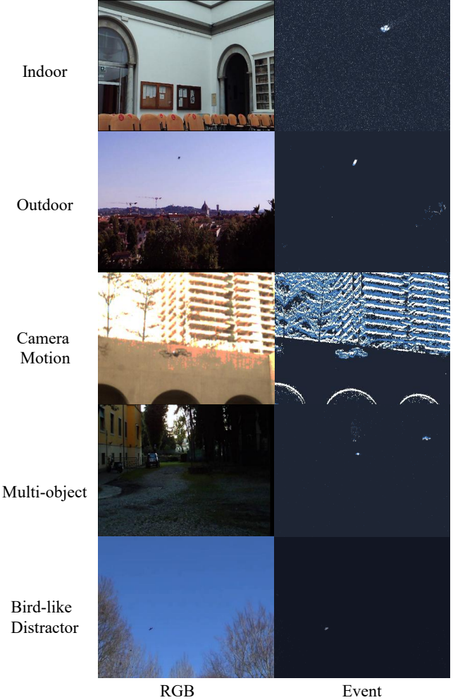

# REUB-Det

REUB-Det is an RGB–Event dataset for UAV detection. It contains paired RGB images and event representations, with bounding-box annotations for five UAV categories and one Bird category. Birds serve as visually similar distractors for UAV detection.

<!--
## Dataset overview

- **Categories:** Betafpv Air75, DJI Mini 2, DJI Mini 3, DJI Tello EDU, DarwinFPV Cineape20, and Bird.
- **Scale:** Approximately 255K training pairs and 104K test pairs, split by source sequence.
- **Scenarios:** Indoor and outdoor environments, camera motion, multiple targets, and bird distractors.
- **Sources:** UAV sequences are selected from FRED and VisEvent. Bird sequences use consecutive RGB frames from [Drone-detection-dataset](https://github.com/DroneDetectionThesis/Drone-detection-dataset), with corresponding events synthesized using [v2e](https://github.com/SensorsINI/v2e).
-->

## Representative samples

## Availability

Dataset files and annotations have not yet been released. This repository currently provides an overview and representative samples.
